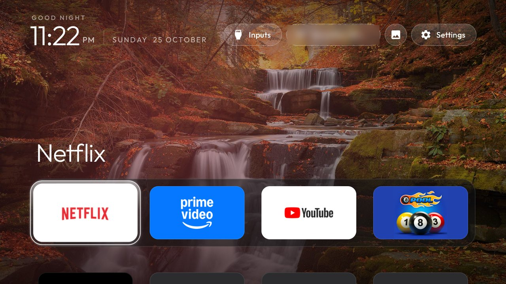
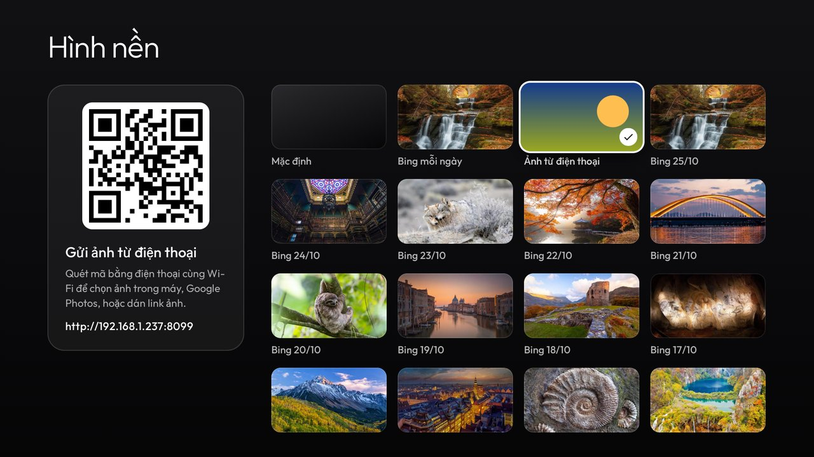
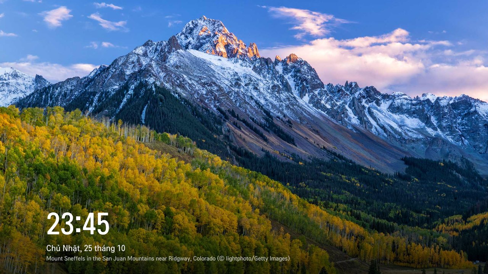

# WebOS Sensation VN

Màn hình chính kiểu Apple TV cho TV LG chạy webOS, có hình nền Bing, gửi ảnh từ điện thoại, trình
bảo vệ màn hình riêng và nút Home luôn về launcher. Phát triển tiếp từ
[webos-vibehack](https://github.com/OmkarK97/webos-vibehack) của OmkarK97, vốn là bản webOS của
[tv-vibehack](https://github.com/Gathin23/tv-vibehack) (Android TV) của Gathin.



Đã thử trên LG 65UQ7550PSF (webOS 7.6, firmware 04.60.91), đã root bằng Homebrew Channel.
Bản gốc tiếng Anh, kèm cách cài bằng Developer Mode, ở [README.en.md](README.en.md).

## Tính năng

- **Launcher kiểu Apple TV**: hàng dock 4 app, lưới app bên dưới, ánh màu theo app đang chọn.
  Icon lấy bản 192 px trên TV (nét hơn bản 130 px LG cho phép tải), màu nền ô tính sẵn trên máy tính.
- **Hình nền**: ảnh Bing tự đổi mỗi ngày, hoặc chọn một trong ~15 ảnh Bing gần nhất, hoặc ảnh của bạn.
- **Gửi ảnh từ điện thoại**: quét mã QR trên TV, chọn ảnh trong máy (Android có cả Google Photos)
  hoặc dán link chia sẻ Google Photos / link ảnh bất kỳ. Ảnh hiện lên TV ngay.
- **Giữ OK trên một ô app** (hoặc phím Info / phím đỏ): Di chuyển, Ẩn, Gỡ cài đặt, Hiện lại app đã ẩn.
- **Nút Home luôn về launcher**. Màn hình LG vẫn mở được bằng nút ngôi nhà trên thanh trên cùng.
  Bật TV vào Live TV hay HDMI không tín hiệu cũng tự về launcher.
- **Trình bảo vệ màn hình riêng**: trình chiếu ảnh Bing và ảnh gửi từ điện thoại, có đồng hồ tiếng
  Việt, ảnh và đồng hồ di chuyển chậm để tránh lưu ảnh trên màn OLED. Thay luôn phần quảng cáo của LG.
- **Nhẹ hơn**: tuỳ chọn không cho Google Assistant nằm sẵn trong RAM (khoảng 40 MB).

| Chọn hình nền | Trình bảo vệ màn hình |
|---|---|
|  |  |

## Cần có

- TV LG webOS **đã root bằng [Homebrew Channel](https://github.com/webosbrew/webos-homebrew-channel)**.
  Nút Home, screensaver, gỡ app, tự đọc danh sách app và bỏ Google Assistant chỉ làm được khi có
  root. TV chưa root vẫn dùng được launcher và hình nền qua Developer Mode, xem
  [README.en.md](README.en.md).

## Cài đặt nhanh: chỉ cần remote (khuyên dùng)

1. Trên TV, mở **Homebrew Channel** → **Settings** (bánh răng) → **Add repository**, nhập:

   ```
   https://sensationy2k.github.io/WebOS-Sensation-VN/apps.json
   ```

   Gõ địa chỉ này bằng bàn phím trên màn hình, hoặc bằng điện thoại qua ứng dụng LG ThinQ.
2. Quay lại danh sách app của Homebrew Channel, chọn **WebOS Sensation VN** → **Install**.
3. Mở app **Home** vừa cài. Lần đầu, launcher tự xin quyền root từ Homebrew Channel và đọc danh sách
   app của TV ("Đang thiết lập lần đầu…", có thể mất khoảng nửa phút).
4. Bật các tính năng ở **Settings → Tính năng nâng cao** (xem phần Sử dụng).

Bản mới sẽ hiện trong Homebrew Channel như các app khác. Cập nhật xong, mở launcher một lần để nó
xin lại quyền root (Homebrew Channel đặt lại quyền sau mỗi lần cài).

**Phím tắt**: khi đang mở launcher, giữ một phím số trên remote (ví dụ **1**) để gán. Từ đó giữ
phím 1 ở đâu cũng mở launcher.

## Cài từ máy tính (cho người phát triển)

Cần máy tính cùng mạng Wi-Fi với TV, có [Node.js](https://nodejs.org) (công cụ `ares` của LG được
tải tự động qua `npx`), [Python 3](https://www.python.org) và Git (trên Windows, chạy các lệnh
trong **Git Bash**), và **SSH** bật trong phần cài đặt của Homebrew Channel.

**1. Tạo khoá SSH và cho TV tin khoá đó** (một lần). `192.168.1.50` là IP của TV, xem trong
Cài đặt → Mạng của TV. Lệnh thứ hai hỏi mật khẩu root của TV (mặc định của Homebrew Channel là
`alpine`).

```bash
ssh-keygen -t ed25519 -N "" -f ~/.ssh/tvkey
cat ~/.ssh/tvkey.pub | ssh root@192.168.1.50 "mkdir -p ~/.ssh && cat >> ~/.ssh/authorized_keys"
```

**2. Tải mã nguồn và thư viện Python**

```bash
git clone https://github.com/Sensationy2k/WebOS-Sensation-VN.git
cd WebOS-Sensation-VN
python -m venv venv
venv/Scripts/pip install websockets pillow      # macOS / Linux: venv/bin/pip
```

**3. Cài lên TV**

```bash
TV_HOST=192.168.1.50 TV_SSH_KEY=~/.ssh/tvkey HOME_WATCH=1 SCREENSAVER=1 NO_ASSISTANT=1 ./install-root.sh
```

Lần chạy đầu, TV hỏi **"Cho phép thiết bị này?"**: bấm đồng ý. Script đóng gói, cài launcher kèm
dịch vụ, xin quyền root cho dịch vụ, bật các tính năng đã chọn rồi mở launcher. `HOME_WATCH`,
`SCREENSAVER`, `NO_ASSISTANT` là ba công tắc trong **Tính năng nâng cao**; bỏ cái nào không muốn.

**Phát hành bản mới**: tăng `version` trong `app/appinfo.json` (và `VERSION` trong `app/app.js`),
chạy `./make-release.sh`, tạo GitHub release `v<version>` kèm file `.ipk` trong `build/release/`,
rồi commit `docs/apps.json` và `docs/manifest.json`.

## Sử dụng

- **Mũi tên / OK**: chọn và mở app. Bấm lên từ hàng dock để tới các nút trên cùng.
- **Nút trên cùng**: Inputs (HDMI, Live TV), Wi-Fi, **Hình nền**, **Màn hình LG** (ngôi nhà), **Settings**.
- **Giữ OK trên một ô** (hoặc phím Info / phím đỏ) để mở menu:
  - **Di chuyển**: mũi tên để dời ô (lên hàng đầu là vào dock), OK để đặt, Back để huỷ.
  - **Ẩn**: giấu icon, app vẫn còn. **Hiện lại app đã ẩn** có trong cùng menu.
  - **Gỡ cài đặt**: có hỏi xác nhận, chọn sẵn Huỷ. Không có với app hệ thống của LG và Homebrew Channel.
- **Settings**:
  - **Cài đặt TV**: cài đặt của LG.
  - **Tính năng nâng cao**: bấm OK để bật/tắt từng mục:
    - **Nút Home luôn mở launcher**: bật TV vào Live TV hay HDMI không tín hiệu cũng về launcher.
    - **Trình bảo vệ màn hình Bing và ảnh**: thay luôn quảng cáo trong screensaver của LG.
    - **Không giữ Google Assistant trong RAM**: tắt đi thì khởi động lại TV để có lại.
  - **Làm mới danh sách app**: danh sách cũng tự làm mới mỗi lần quay về launcher.
- **Hình nền**: mở nút hình ảnh. Chọn Mặc định, Bing mỗi ngày, một ảnh Bing, hoặc quét mã QR bằng
  điện thoại cùng Wi-Fi để gửi ảnh. Trang gửi ảnh chỉ mở khi bảng Hình nền đang mở trên TV. Ảnh gửi
  lên cũng được thêm vào trình bảo vệ màn hình (giữ 60 ảnh mới nhất).
- **Màn hình LG** (cho các menu của LG): nút ngôi nhà. Ở đó bấm Home không bị kéo về launcher; mở
  app khác xong, Home lại về launcher như thường.

## Gỡ bỏ

Mọi thay đổi trên TV đều đảo ngược được, file hệ thống của LG không bị sửa:

- Tắt các mục trong **Settings → Tính năng nâng cao** trước, rồi gỡ app **Home** trong Homebrew
  Channel (hoặc như mọi app khác).
- Gỡ app trước mà chưa tắt: các script vẫn nằm trong `/var/lib/webosbrew/init.d/` (`tvhome-homewatch`,
  `tvhome-screensaver`, `tvhome-noassistant`). Xoá chúng qua SSH rồi khởi động lại TV.

Ảnh gửi từ điện thoại nằm ở `/media/internal/tvhome-photos`.

## Xử lý sự cố

- **Không có danh sách app, hoặc Tính năng nâng cao báo "Cần TV đã root"**: launcher chưa xin được
  quyền root. Kiểm tra Homebrew Channel báo **Root status: ok** trong Settings của nó, rồi mở lại launcher.
- **Nút Home không về launcher**: xem `/tmp/tvhome-homewatch.log` trên TV.
- **Tự viết lệnh `luna-send` qua SSH không ra gì**: trên firmware này `luna-send` cần một terminal.
  Dùng `ssh -t`, hoặc chạy trong `script -q -c "..." /dev/null`.
- **Không hiện hộp thoại ghép nối khi cài từ máy tính**: bật tuỳ chọn kết nối từ ứng dụng di động
  (Cài đặt → Chung → Thiết bị → "LG Connect Apps" hoặc tương tự).

## Các file

| File | Làm gì |
|---|---|
| [`app/`](app/) | Launcher: `index.html`, `style.css`, `app.js`, `config.js`, `appinfo.json` |
| [`service/`](service/) | Dịch vụ Node trên TV: danh sách app, trang gửi ảnh, ảnh Bing, gỡ app, tính năng nâng cao |
| [`service/tv/screensaver.qml`](service/tv/screensaver.qml) | Trình bảo vệ màn hình |
| [`install-root.sh`](install-root.sh) | Cài từ máy tính lên TV đã root qua SSH |
| [`make-release.sh`](make-release.sh) | Đóng gói bản phát hành và repo Homebrew Channel (`docs/apps.json`) |
| [`sync-apps.py`](sync-apps.py) | Đọc app và icon từ máy tính vào `app/apps.js` (khi chưa có root) |
| [`service/tv/home-watch.sh`](service/tv/home-watch.sh) | Nút Home về launcher, chạy trên TV |
| [`service/tv/screensaver.sh`](service/tv/screensaver.sh) | Gắn trình bảo vệ màn hình mới mỗi lần khởi động |
| [`service/tv/no-assistant.sh`](service/tv/no-assistant.sh) | Không cho Google Assistant nằm sẵn trong RAM |
| [`install.sh`](install.sh), [`home-watch.py`](home-watch.py) | Cách gốc cho TV chưa root (Developer Mode), xem README.en.md |
| [`lgtv.py`](lgtv.py) | Kết nối dịch vụ điều khiển từ xa của TV |

## Ghi công

Thiết kế, bố cục và icon từ [tv-vibehack](https://github.com/Gathin23/tv-vibehack) của
[Gathin](https://github.com/Gathin23); bản webOS gốc
[webos-vibehack](https://github.com/OmkarK97/webos-vibehack) của OmkarK97. Font Outfit theo
SIL Open Font License ([`app/fonts/OFL.txt`](app/fonts/OFL.txt)). Thư viện QR
[qrcode-generator](https://github.com/kazuhikoarase/qrcode-generator) của Kazuhiko Arase (MIT).
Giấy phép MIT, xem [`LICENSE`](LICENSE).
